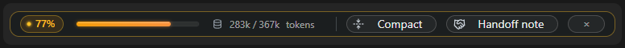

# Context gauge for Claude Code

A slim band above the prompt that shows how full the context is, up to the point where Claude Code compacts it automatically.



- **The bar ends at the auto-compaction threshold**, so 100% means "Claude Code is about to compact". With auto-compaction off, it ends at the model's context window.
- **Green, then orange from 70%, then red from 90%.**
- **Compact** compacts the conversation now. Pressed during a turn, it waits for the turn to end.
- **Handoff note** asks Claude to write a note (goal, state, decisions, files, next step) so you can continue in a fresh session.
- **×** hides the band for the rest of the session.

It works in the terminal and in the desktop app.

## Install

This is a Claude Code mod. It needs Claude Code 2.1.275 or later.

At the prompt of a Claude Code terminal session:

```
/plugin install context-claude --marketplace jceou-labs/claude-context
```

Answer `y` to add the marketplace, then pick a scope (Enter keeps the user scope, so the band shows in every session).
The plugin is named `context-claude`, not `claude-context` like the repository: Claude Code reserves plugin names
that start with `claude-`.

From a shell:

```
claude plugin install context-claude --marketplace jceou-labs/claude-context
```

In the desktop app, where `/plugin` doesn't run: click + next to the prompt box, then Plugins, Add marketplace with `jceou-labs/claude-context`, then Add plugin. A mod installed from a terminal at the user scope also shows in the desktop app.

## Notes

- Right after a compaction, Claude Code doesn't measure the context until the next reply. The band shows the size after compaction when Claude Code reports it, and a dash otherwise.
- In the desktop app, Compact runs the `/compact` command.

## See also

- [claude-workflow-skills](https://github.com/jceou-labs/claude-workflow-skills): nine skills that keep long Claude Code work on track across sessions and projects.
- [claude-project-tracker](https://github.com/jceou-labs/claude-project-tracker): offline pages showing where your projects stand, kept up to date by Claude.
- [claude-local-images](https://github.com/jceou-labs/claude-local-images): lets Claude generate images on your own graphics card, free and private.

## License

MIT
