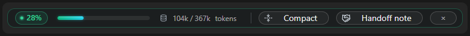
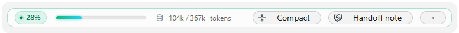
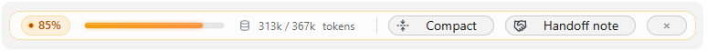

# Context gauge for Claude Code

A slim band above the prompt that shows how full the context is, up to the point where Claude Code compacts it automatically.








- **The bar ends at the auto-compaction threshold**, so 100% means "Claude Code is about to compact". With auto-compaction off, it ends at the model's context window.
- **Emerald to cyan, then amber from 70%, then red from 90%.** The pill around the percentage and the band's border take the same color.
- **Compact** compacts the conversation now. Pressed during a turn, it waits for the turn to end.
- **Handoff note** asks Claude to write a note (goal, state, decisions, files, next step) so you can continue in a fresh session.
- **×** hides the band for the rest of the session.

It works in the terminal and in the desktop app. The desktop app, VS Code and the mobile app draw it as a glass bar with a gradient gauge and icons, dark or light with the app's theme; the terminal draws a text gauge.

## Install

This is a Claude Code mod. It needs Claude Code 2.1.275 or later.

At the prompt of a Claude Code terminal session:

```
/plugin install context-claude --marketplace jceou-labs/claude-context
```

Answer `y` to add the marketplace, then pick a scope (Enter keeps the user scope, so the band shows in every session).
The plugin is named `context-claude`, not `claude-context` like the repository: Claude Code reserves plugin names
that start with `claude-`.

From a shell:

```
claude plugin install context-claude --marketplace jceou-labs/claude-context
```

In the desktop app, where `/plugin` doesn't run: click + next to the prompt box, then Plugins, Add marketplace with `jceou-labs/claude-context`, then Add plugin. A mod installed from a terminal at the user scope also shows in the desktop app.

## Compacting earlier

By default, models with a 1M-token window compact at about 967K tokens. To compact earlier, set `autoCompactWindow` in `~/.claude/settings.json` (100000 or more), for example `"autoCompactWindow": 400000`. The band then ends at that value.

A lower window does two things:

- **It saves tokens.** Claude Code sends the whole conversation with every request, so each message costs more as the context grows. Cached parts are cheaper but still count ([Claude Code docs](https://code.claude.com/docs/en/costs)).
- **It may keep answers sharper.** Models recall less accurately as the context grows, gradually rather than past a fixed point ([Anthropic](https://www.anthropic.com/engineering/effective-context-engineering-for-ai-agents), [Chroma](https://www.trychroma.com/research/context-rot)). No source says where this starts for current 1M-token models.

Anthropic doesn't recommend a value. 400K is a popular pick, not an official rule. A compaction keeps a summary and drops details, so when you switch to unrelated work, `/clear` or a Handoff note works better.

## Notes

- Right after a compaction, Claude Code doesn't measure the context until the next reply. The band shows the size after compaction when Claude Code reports it, and a dash otherwise.
- In the desktop app, Compact runs the `/compact` command.

## See also

- [claude-workflow-skills](https://github.com/jceou-labs/claude-workflow-skills): nine skills that keep long Claude Code work on track across sessions and projects.
- [claude-project-tracker](https://github.com/jceou-labs/claude-project-tracker): offline pages showing where your projects stand, kept up to date by Claude.
- [claude-local-images](https://github.com/jceou-labs/claude-local-images): lets Claude generate images on your own graphics card, free and private.

## License

MIT
